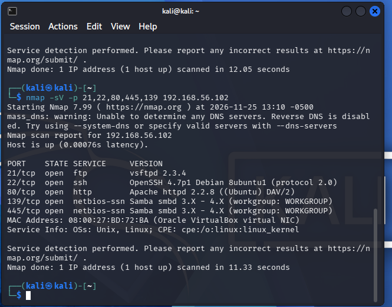

# Ataque de Força Bruta com Medusa e Kali Linux

## Sobre o projeto

Este projeto foi desenvolvido como parte de um desafio prático de cibersegurança.

O objetivo é compreender o funcionamento de ataques de força bruta e conhecer a ferramenta Medusa utilizando o Kali Linux em um ambiente de laboratório controlado.

## Objetivos

- Conhecer a ferramenta Medusa.
- Compreender o funcionamento de ataques de força bruta.
- Estudar vulnerabilidades relacionadas à autenticação.
- Aprender sobre segurança de senhas.

## Ferramentas utilizadas

- Kali Linux
- Medusa
- Nmap
- DVWA (Damn Vulnerable Web Application)

## Desenvolvimento

Nesta seção serão documentadas as etapas realizadas durante o desafio, os comandos estudados e as observações obtidas durante as atividades práticas.

## Resultados

Espaço destinado ao registro dos resultados dos testes realizados no laboratório.

## Aprendizados

Durante este desafio, foram estudados conceitos de força bruta, autenticação, segurança de senhas e ferramentas utilizadas em testes de segurança.

## Considerações finais

Este projeto contribuiu para o desenvolvimento dos meus conhecimentos em cibersegurança e para a compreensão prática de técnicas utilizadas em testes de invasão.

## Evidências do projeto

### Capturas de tela

## Evidências do projeto

### 1. Reconhecimento com Nmap

.

### 2. Execução do Medusa

### 3. Resultado do teste

